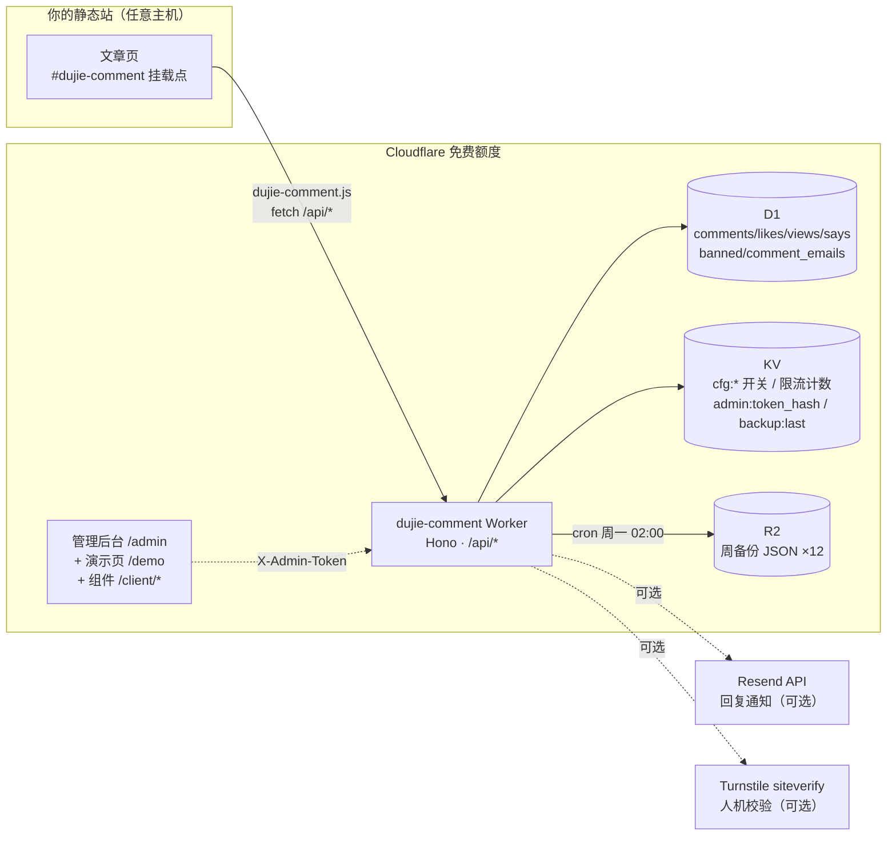

# 为什么不用 Twikoo

Twikoo 要一台服务器、Waline 要一台服务器 + LeanCloud、Giscus 数据在 GitHub Discussions 且国内加载看运气——**dujie-comment 把评论系统整个跑在 Cloudflare 免费额度上：0 台服务器、0 个数据库账号、`fork → wrangler deploy` 两条命令上线，数据 100% 在你自己的 D1 里。**

```html
<link rel="stylesheet" href="https://<your-worker>/client/dujie-comment.css">
<div data-dujie-comment data-api="https://<your-worker>" data-slug="my-post-1"></div>
<script src="https://<your-worker>/client/dujie-comment.js" defer></script>
```

**[🎮 在线演示](https://dujie-comment.dujie.workers.dev/demo)** · **[🛡️ 管理后台](https://dujie-comment.dujie.workers.dev/admin)** · **[📖 部署文档](docs/deploy.md)** · **[📑 API 契约](docs/api.md)**

---

## 对比

| | Twikoo | Waline | Giscus | **dujie-comment** |
| --- | --- | --- | --- | --- |
| 部署难度 | 自建 Vercel/服务器 | 自建服务器 + LeanCloud | GitHub App 授权 + Discussions | **`wrangler deploy` 一条命令** |
| 国内可达 | 看服务器位置 | 看服务器位置 | ❌ 看运气（国内常抽风） | ✅ Workers 全球边缘，国内直连 |
| 外部依赖 | Vercel/服务器 | LeanCloud/MongoDB | GitHub 账号体系 | **无**（Cloudflare 免费额度） |
| 月成本 | 服务器 ¥30+ | 服务器 ¥30+ / LeanCloud | 免费 | **¥0**（D1 5GB + KV 10万次/天 + R2 10GB 免费额度） |
| 数据归属 | 自建库 | LeanCloud/自建库 | GitHub Discussions | **自有 D1，一键全量导出 R2 周备份** |

## 功能

- 💬 **树形回复**：无限层级回复、Gravatar 头像、@提及、相对时间
- ❤️ **点赞**：文章 + 评论双维度，同指纹 toggle（重复点 = 取消）
- 👁 **浏览量**：文章级 UV 计数，批量统计接口
- 🛡 **审核状态机**：`approved / pending / hidden` 三态，后台一键审核/隐藏/删除/拉黑（邮箱 / IP 双维度）
- 🤖 **Turnstile 人机校验**：可选开启，三分支降级（服务不可达默认放行）
- 🚫 **指纹限流**：同 IP+UA 每分钟 2 条评论；不存明文 IP（双轨哈希）
- 📧 **回复邮件通知**：Resend 发送，未配置自动降级（不影响评论）
- 💾 **周备份**：cron 每周一全量导出 D1 → R2，保留 12 份
- 🎨 **暗/亮双主题**：CSS 变量驱动，跟随系统偏好
- 📱 **零依赖嵌入组件**：vanilla JS + `<script src>` 即用，Shadow-DOM 级样式隔离（`dc-` 前缀，不污染宿主页）
- 🔐 **管理后台**：单文件 HTML，X-Admin-Token 模式，KV 只存 SHA-256 哈希，失败限流防爆破

## 架构



## 快速开始（3 步）

详细版（含每步截图级说明）见 [docs/deploy.md](docs/deploy.md)，这里是骨架：

```bash
# 1. Fork 后克隆并创建资源（D1 + KV + R2）
git clone https://github.com/<你>/dujie-comment.git && cd dujie-comment
npm install
npx wrangler d1 create dujie-comment-db        # 抄下 database_id
npx wrangler kv namespace create dujie-comment-kv   # 抄下 id
npx wrangler r2 bucket create dujie-comment-backup

# 2. 把资源 ID 抄进 wrangler.toml，初始化数据库，部署
npx wrangler d1 execute DB --file=schema.sql --remote
npx wrangler deploy

# 3. 在你的文章模板加入两行代码（地址换成你的 worker 域名）
```

```html
<link rel="stylesheet" href="https://dujie-comment.<你的子域>.workers.dev/client/dujie-comment.css">
<div data-dujie-comment
     data-api="https://dujie-comment.<你的子域>.workers.dev"
     data-slug="文章唯一标识"
     data-author="博主昵称"></div>
<script src="https://dujie-comment.<你的子域>.workers.dev/client/dujie-comment.js" defer></script>
```

打开 `https://<你的 worker>/admin`，输入第 5 步设置的管理令牌即可开始审核。

## API 摘要

完整契约（含全部错误码）见 [docs/api.md](docs/api.md)。

| 方法 | 路径 | 说明 |
| --- | --- | --- |
| GET | `/api/config` | 灰度开关（Turnstile/审核/通知） |
| GET | `/api/comments?slug=` | 评论树（已审核） |
| POST | `/api/comments` | 发表评论 / 回复（限流 + Turnstile + 黑名单） |
| POST | `/api/like` | 文章/评论点赞 toggle |
| POST | `/api/view` | 浏览量 +1 |
| GET | `/api/stats?slugs=` | 批量统计 |
| GET | `/api/says` | 说说列表 |
| GET | `/api/admin/comments` | 管理：评论列表（过滤/分页/搜索） |
| POST | `/api/admin/comments/:id/approve` | 审核通过（回复则触发通知） |
| POST | `/api/admin/comments/:id/hide` | 软删除 |
| DELETE | `/api/admin/comments/:id` | 硬删除（子评论提升为根） |
| POST | `/api/admin/comments/:id/ban` | 拉黑（email/ip/both） |
| GET/DELETE | `/api/admin/bans[/:id]` | 黑名单列表 / 解除 |
| GET | `/api/admin/stats` | 驾驶舱（状态分布/黑名单/上次备份） |

管理端点统一走 `X-Admin-Token` 请求头；令牌只以 SHA-256 存于 KV。

## 隐私设计

- **不存明文 IP**：`ip_hash = sha256(IP|ipban|salt)`，仅用于黑名单与限流；
- **邮箱隔离**：`comments` 表只存 `email_md5`（Gravatar 头像），明文邮箱单独存 `comment_emails`，仅用于回复通知，不进任何公开查询，管理列表脱敏展示；
- **数据可携带**：R2 周备份即全量 JSON，随时迁走。

## 本地开发

```bash
npm run dev        # wrangler dev（localhost 跨域恒允许）
npm test           # Vitest：全 mock KV/D1/R2/fetch，不触网
npm run typecheck  # tsc --noEmit
```

## 目录结构

```
dujie-comment/
├── worker/                    # Cloudflare Worker（Hono + TypeScript 严格模式）
│   ├── index.ts               #   入口：中间件链 / 路由挂载 / cron 周备份
│   ├── routes/                #   comments（公开 API）/ admin（管理 API）/ backup / static
│   ├── lib/                   #   security（指纹/限流/Turnstile/令牌）/ config（KV 开关）/ notify（Resend）
│   ├── types.ts               #   Env 绑定与 Hono 上下文类型
│   └── raw.d.ts               #   文本模块导入类型声明
├── client/                    # 嵌入组件（vanilla JS，零构建，即引即用）
│   ├── dujie-comment.js
│   └── dujie-comment.css
├── admin/index.html           # 管理后台（单文件，token 模式，API 地址可改）
├── demo/index.html            # 在线演示页
├── docs/                      # 部署指南 + API 契约
├── tests/                     # Vitest：单测（全 mock）+ 集成测（node:sqlite 真库）
├── scripts/push-to-github.mjs # 经 Git Data API 推送仓库（免 git 协议）
├── .github/workflows/         # CI：test → deploy → 线上冒烟（部署后自验证）
├── schema.sql                 # D1 建表（幂等）
└── wrangler.toml              # D1/KV/R2 + cron + CORS_ORIGINS（示例值，全部可配）
```

## 技术栈

Cloudflare Workers · D1 (SQLite) · KV · R2 · Hono · TypeScript · Vitest

## License

[MIT](LICENSE) © dujie-comment contributors
